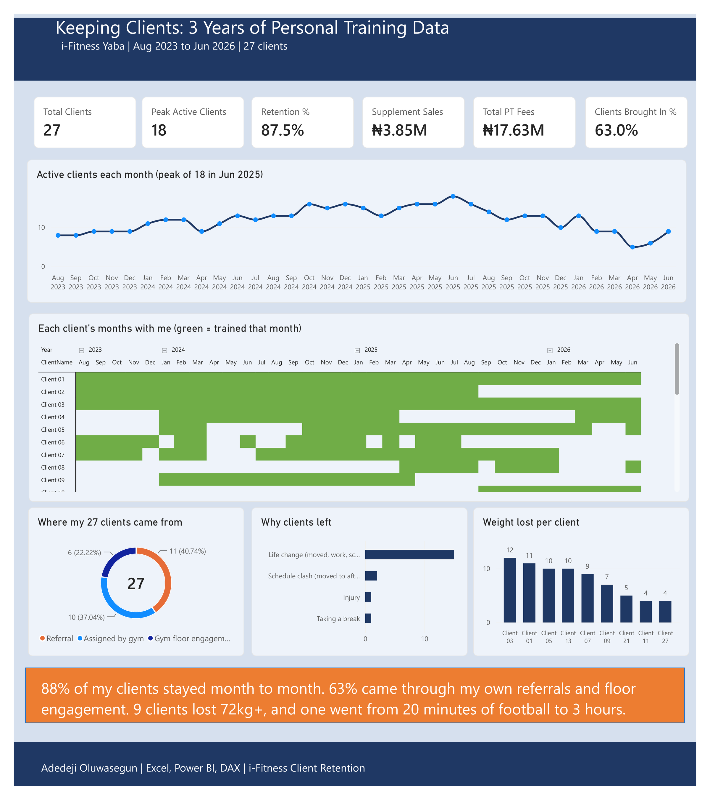
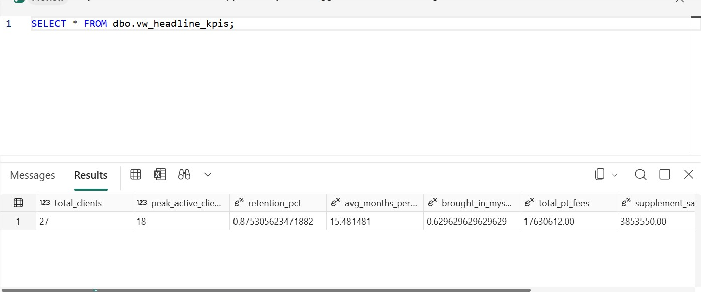
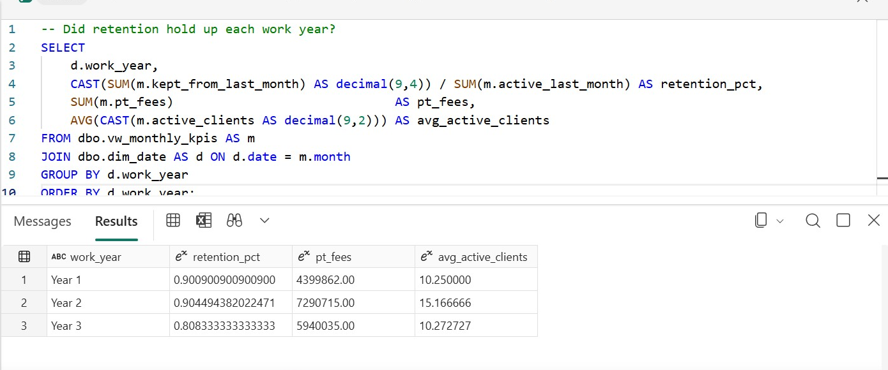
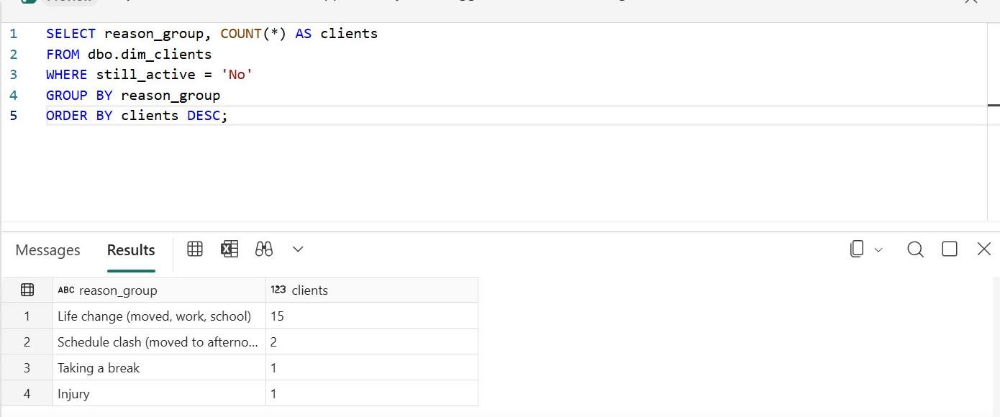

# Keeping Clients: 3 Years of Personal Training Data

I worked as a personal trainer at i-Fitness, Yaba (Lagos) from August 2023 to June 2026. Selling supplements and keeping clients was part of the job, and I tracked my clients the whole time. This project turns those 3 years of real records into an analysis of what kept clients coming back, where new clients came from, and what it was worth.



## What I found

| Question | Answer |
|---|---|
| How many clients did I train? | **27** |
| How much did my client base grow? | From **8** in my first month to a peak of **18** (June 2025) |
| How many clients stayed month to month? | **87.5%** overall (Year 1: 90.1%, Year 2: 90.4%, Year 3: 80.8%) |
| How long did a client stay? | **15.5 months** on average. 14 stayed a year or more, 6 stayed two years or more |
| Where did clients come from? | **63%** I brought in myself: 11 referrals and 6 from gym floor engagement |
| Did referrals come from a few people? | No. **11 different clients** each referred someone |
| Did price increases push people away? | **15 clients** were paying a higher rate at the end than at the start and kept training |
| Why did people leave? | 15 of 19 left for life changes (moving, work, school). 2 left when their schedule moved to afternoons. None of the reasons I recorded were price or service |
| What did it bring in? | **₦17.63M** in PT fees (up 66% from year 1 to year 2) and **₦3.85M** in supplements and accessories |
| What did clients achieve? | 9 clients lost a combined **72kg+**. One went from under 20 minutes of football to about 3 hours |

**What a gym owner could do with this:** the 2 clients lost to schedule clashes point to a simple fix (offer afternoon slots or hand them over to an afternoon trainer instead of losing them). And since most growth came from referrals, a small referral reward is likely the cheapest way to grow a trainer's client base.

## How I built it

1. **Excel:** a tracker for all 27 clients: monthly PT payments, supplement sales, referrals, challenges and results. Formulas work out retention, comebacks and tax.
2. **Power BI:** a data model (Calendar, Clients, PT payments, Sales, Costs, Progress) with 25+ DAX measures and a one-page dashboard. See [powerbi/dax_measures.md](powerbi/dax_measures.md).
3. **Microsoft Fabric:** the raw CSVs go into a **lakehouse**, then SQL copies them into a **warehouse** as clean tables, with views that answer the business questions.

### Fabric SQL results (they match the dashboard)





## Files

```
data/
  csv/                               6 tables loaded into the Fabric lakehouse
  iFitness_Yaba_PowerBI_Data.xlsx    clean tables for Power BI
  iFitness_Yaba_Tracker_ShareSafe.xlsx  the full Excel tracker
sql/
  01_load_lakehouse_to_warehouse.sql  copy lakehouse tables into the warehouse
  02_create_views.sql                 monthly KPIs, client summary, source summary, headline KPIs
  03_business_questions.sql           the questions above, answered in SQL
powerbi/
  dax_measures.md                     every DAX measure, with notes
  iFitness_Theme.json                 report colours
images/                               dashboard and SQL screenshots
```

## Notes on the data

- **Privacy:** client names and member IDs are replaced (Client 01, #P001 and so on). Company target figures from i-Fitness are not included.
- **Estimates:** in 8 months I sold supplements but didn't keep exact figures. Those months are entered at ₦100,000 each and marked as estimates (my real sales were higher).
- **Gym memberships:** every month a client paid for PT, they also held a gym membership, so membership months are counted from the PT payments.
- **Tax:** worked out from the Lagos (LIRS) bands on what was left after the service charge, without pension or rent relief.

## Tools

Excel (formulas, data validation) · Power BI (DAX, data modelling) · Microsoft Fabric (Lakehouse, Warehouse, T-SQL)

---
Adedeji Oluwasegun John · [LinkedIn](https://www.linkedin.com/in/adedejioluwasegun) · [Portfolio](https://hunter-ai124.github.io)
